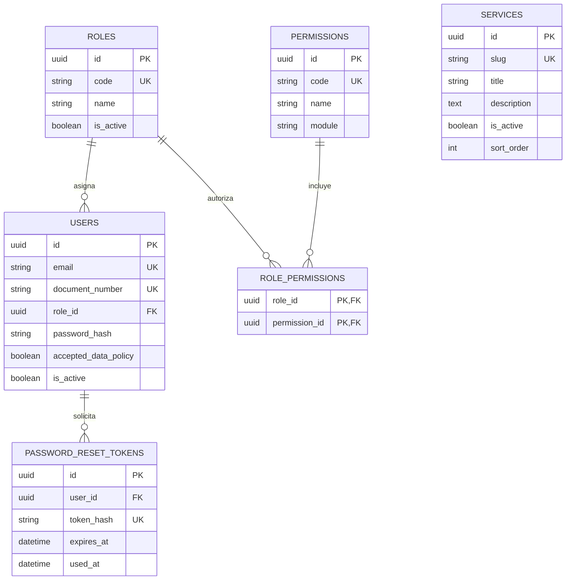

# Modelo entidad-relación

El motor objetivo es PostgreSQL administrado en Neon. La API se conecta al endpoint pooled por TLS; el diagrama y las tablas corresponden al schema `public` de la base Neon.

Un usuario tiene un rol; un rol reúne permisos mediante la relación muchos-a-muchos `role_permissions`. Los tokens de recuperación se guardan como hashes y vencen. Los servicios son un catálogo independiente. La cuenta administrativa inicial se crea sin contraseña utilizable y se habilita con `python -m app.seed_admin`, que lee las credenciales locales desde `backend/.env`.
